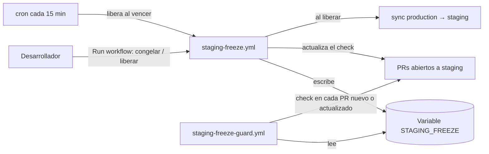

# Staging Freeze

Prototipo funcional de un **congelamiento de la rama `staging`**: mientras
alguien hace pruebas críticas en staging, GitHub impide mergear a esa rama y
cada PR muestra quién la congeló, por qué y hasta cuándo.

## El problema

Hoy, para pedir que nadie despliegue en staging, se escribe en el chat del
equipo. El mensaje se pierde en el día a día, alguien mergea sin verlo, el
despliegue interrumpe las pruebas y se retrasan las entregas de todos.

El aviso tiene que estar **donde se hace el merge**, y tiene que **bloquear**,
no solo informar.

## La propuesta

Un check obligatorio en los PR a `staging`, controlado por un botón en GitHub
Actions. Sin servidores, sin bots externos y sin tocar Odoo.

| Estado | Lo que ve el equipo |
|---|---|
| Libre | Nada distinto: el check `staging-freeze` sale en verde |
| Congelado | El check sale en rojo — *"Congelado por @usuario hasta 15:30: motivo"* — y el botón de merge queda bloqueado |

### Piezas

| Archivo | Qué hace |
|---|---|
| `.github/workflows/staging-freeze.yml` | Botón para congelar o liberar (motivo y horas, 1-24). Libera solo al vencer, con un cron que no gasta minutos mientras no haya congelamiento. Al cambiar de estado, actualiza el check de todos los PR abiertos. |
| `.github/workflows/staging-freeze-guard.yml` | Pone el check en cada PR a staging. Usa `pull_request_target`: corre la versión de la rama base, así que un PR no puede modificar el guard para aprobarse solo. |
| `.github/actions/staging-freeze-status/` | Lógica compartida: decide verde o rojo y redacta el mensaje. Un congelamiento vencido ya cuenta como liberado, aunque el cron no haya pasado. |
| `.github/workflows/sync-production-to-staging.yml` | Réplica del sync automático production → staging. No fusiona mientras staging está congelado; se reanuda al liberar. |

## Cómo se usa

1. **Actions → Staging Freeze → Run workflow**
2. `congelar`, un motivo y las horas → todos los PR a staging quedan en rojo.
3. Al terminar, `liberar` (o esperar al vencimiento) → los PR vuelven a verde
   y el sync de production se pone al día.

Reglas cuando hay más de una persona:

- **Un congelamiento a la vez.** Si staging ya está congelado por otra persona,
  `congelar` falla y dice quién lo tiene, hasta cuándo y por qué.
- **El dueño puede volver a congelar** para extender el tiempo o cambiar el motivo.
- **Solo el dueño libera.** Cualquier otra persona tiene que marcar `forzar`, y
  la liberación forzada queda registrada con su nombre en el resumen del run.
- Un congelamiento vencido ya no cuenta: cualquiera puede congelar encima.

## Configuración (una sola vez, requiere admin del repo)

1. **Variable** `STAGING_BRANCH` = `staging` (Settings → Secrets and variables → Actions → Variables).
2. **Token**: un *fine-grained PAT* limitado a este repo, con *Variables: Read and write*,
   guardado como secret `STAGING_FREEZE_TOKEN`. El `GITHUB_TOKEN` de Actions no puede escribir variables.
3. **Protección de `staging`**: *Require status checks to pass* con el check `staging-freeze`.
4. Ejecutar `liberar` una vez para que los PR ya abiertos reciban el check.

## Demo

1. Abrir un PR a `staging` que cambie `demo/version.txt` → check verde.
2. Congelar → el mismo PR pasa a rojo con el motivo; el merge queda bloqueado.
3. Hacer push a `production` → el sync se salta (staging no se toca).
4. Liberar → el PR vuelve a verde y el sync se ejecuta solo.

## Lo que aprendimos para llevarlo al ERP

- **El check obligatorio también frena los push directos**, incluido el del bot de sync.
  Por eso el sync de este prototipo deja el estado `staging-freeze` en el commit de merge
  antes de empujarlo a staging. El sync del ERP necesita el mismo ajuste, o se rompe el día
  que se active la protección.
- Los workflows tienen que estar en las dos ramas: el guard corre desde `staging` y el
  botón y el cron desde la rama por defecto (`production`).
- Es una barrera contra accidentes, no contra abusos: cualquiera con escritura podría
  poner el estado en verde a mano por la API. Para urgencias, la salida prevista es el
  bypass de admin en la protección de rama.

## Siguientes pasos

- **Aviso al equipo**: publicar el congelamiento y la liberación en el canal de Sistemas.
- **Harness de desarrollo**: que el comando que abre PR a staging consulte la misma
  variable y se niegue mientras esté congelado.
- **Odoo** (opcional): un modelo con los botones Congelar/Liberar e historial, que
  escribe la misma variable por la API de GitHub. La mecánica de GitHub no cambia.
